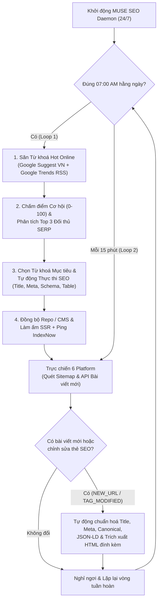

# ERX Autonomous SEO Daemon & Closed-Loop Engine (MUSE Agent Ready)

Hệ thống **Tự động hoá SEO Vòng lặp Khép kín 24/7 (Autonomous Closed-Loop SEO Engine)** dành cho toàn bộ 6 nền tảng trong hệ sinh thái `*.erx.vn`:
- **`erx.vn`** — Cổng thông tin & Kiến thức thực chiến Excel 365, Power BI, SQL, VBA, Supply Chain & Quản lý dự án
- **`community.erx.vn`** (`romantci2710/scm-com`) — Cộng đồng Chuỗi cung ứng, Mua hàng (Procurement) & AI
- **`project-management.erx.vn`** (`romantci2710/Gantt-Planner3.4.3`) — Phần mềm Quản lý Dự án & Sơ đồ Gantt AI chuẩn PMBOK 8
- **`doc-translate.erx.vn`** (`romantci2710/Translator_Machine`) — Công cụ Dịch PDF Học thuật & Công thức Toán LaTeX bằng AI
- **`doc-builder.erx.vn`** (`romantci2710/build_document`) — Công cụ Soạn thảo Hợp đồng, Báo cáo & Kiểm toán Văn bản Pháp lý AI
- **`khoahoc.erx.vn`** — Hệ thống Đào tạo Trực tuyến ERX E-Learning

---

## Kiến trúc 2 Vòng lặp Tự động (Closed-Loop Architecture)



---

## Cài đặt & Khởi chạy trên Server (MUSE Agent / Linux / Docker)

### 1. Chạy bằng Docker Compose (Khuyên dùng cho Server 24/7)
```bash
git clone https://github.com/romantci2710/erx-seo-autonomous-agent.git
cd erx-seo-autonomous-agent
cp .env.example .env
docker compose up -d --build
```

### 2. Chạy trực tiếp bằng Python
```bash
pip install -r requirements.txt

# Chạy chế độ Daemon 24/7 (07:00 AM săn từ khoá + mỗi 15 phút trực bài mới & thẻ SEO):
python muse_seo_daemon.py --mode daemon --daily-time 07:00 --watch-interval 900

# Chạy 1 vòng kiểm thử đầy đủ ngay lập tức (Keyword Cycle + Platform Watcher):
python muse_seo_daemon.py --mode once

# Chạy công cụ phân tích sâu 94+ từ khoá & xuất Dashboard HTML đối thủ:
python keyword_competitor_seo_engine.py
```

---

## Cấu trúc Thư mục

| Đường dẫn | Mô tả chức năng |
| :--- | :--- |
| `muse_seo_daemon.py` | **Trái tim của hệ thống:** Daemon chạy 24/7 thực thi cả 2 vòng lặp (`07:00 AM Keyword SEO Cycle` + `15m Platform Content & Tag Watcher`). |
| `muse_repo_auto_deployer.py` | Tự động đồng bộ các gói từ khoá/FAQ mới sang các repo dịch vụ (`Gantt-Planner3.4.3`, `Translator_Machine`, `build_document`, `scm-com`) và commit/push khi bật `AUTO_GIT_COMMIT=true`. |
| `keyword_competitor_seo_engine.py` | Engine phân tích sâu đối thủ Top SERP và xuất Dashboard tương tác `reports/keyword_competitor_dashboard.html`. |
| `weekly_seo_monitor.py` | Công cụ kiểm toán kỹ thuật chuyên sâu cho toàn bộ 6 tên miền trên Google Search Console. |
| `config/platforms.json` | Cấu hình tập trung 6 nền tảng, danh sách từ khoá hạt giống (seed keywords), tên miền đối thủ và URL trọng tâm. |
| `state/` | Lưu trữ trạng thái bền vững (`seo_state.json`, `platform_watch_state.json`, `keyword_seo_injections.json`) giúp vòng lặp không tối ưu trùng lặp và phát hiện chính xác mọi thay đổi thẻ HTML. |
| `reports/` | Báo cáo Markdown, JSON và HTML tự động cập nhật sau mỗi chu kỳ. |
| `AGENTS.md` | Tài liệu hướng dẫn vận hành chuẩn dành riêng cho **MUSE Server Agent**. |
